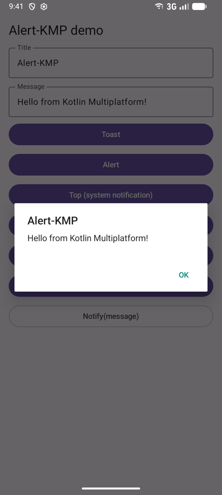
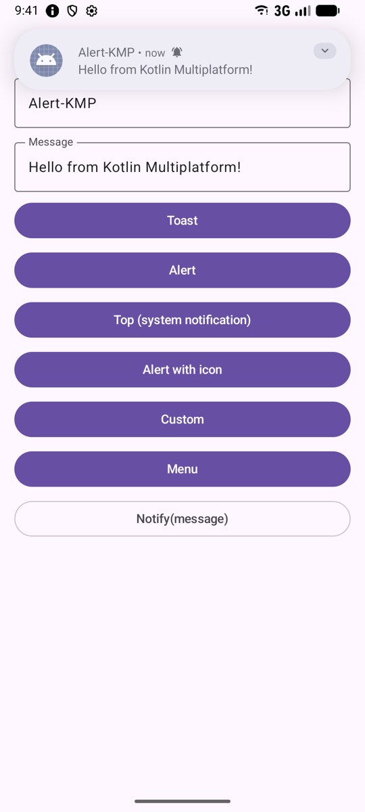
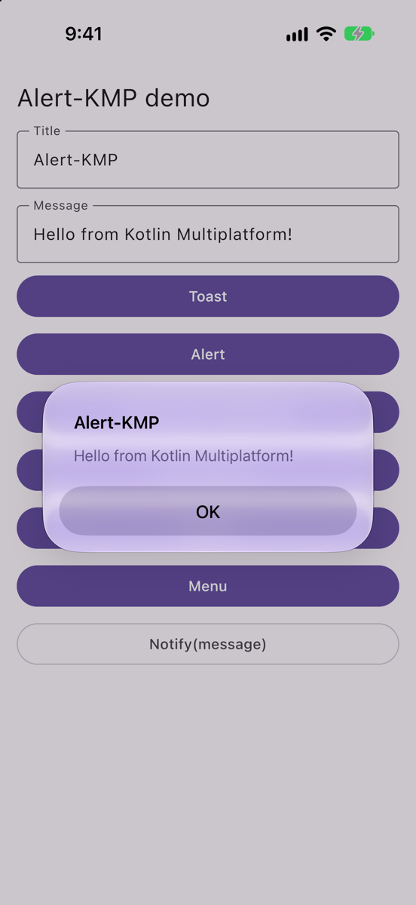
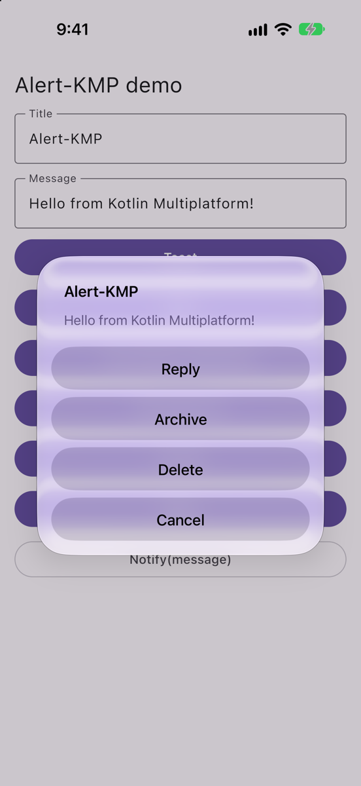
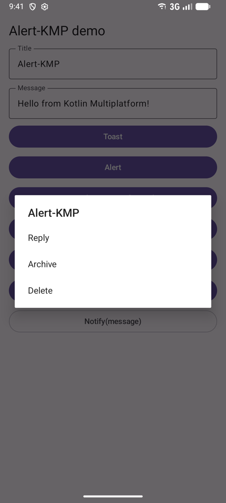
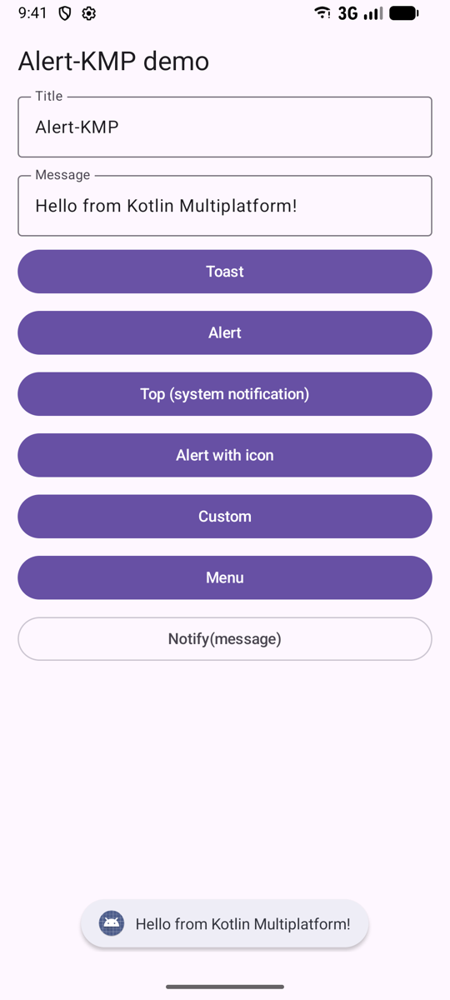
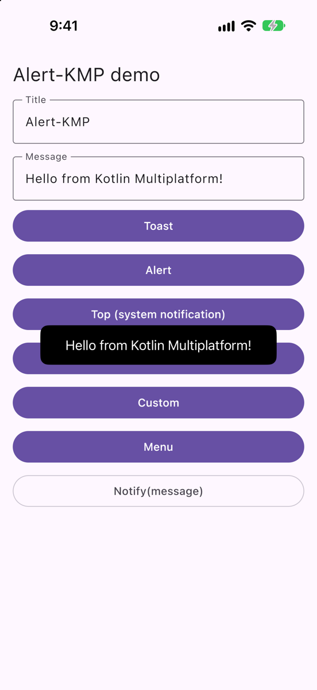
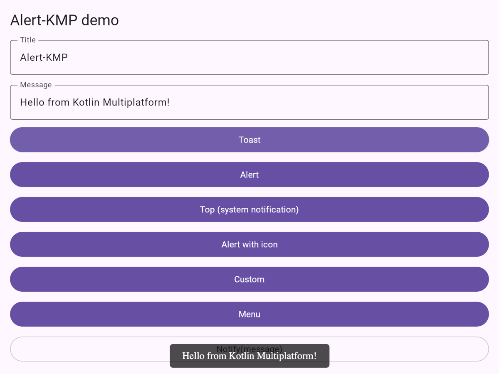
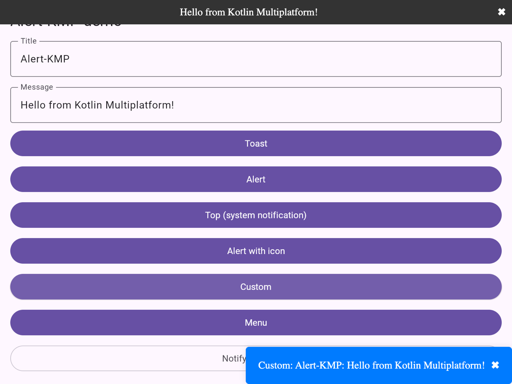
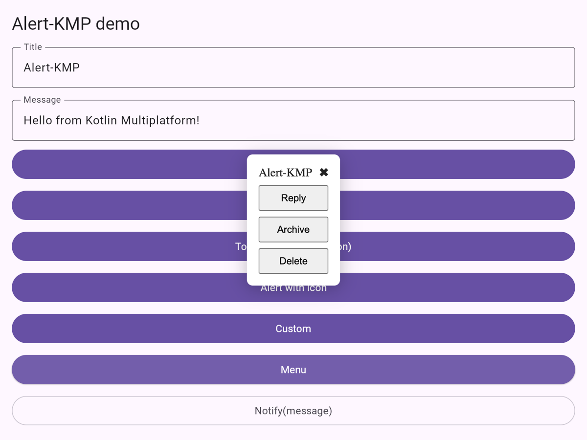

# Alert-KMP

[](https://central.sonatype.com/artifact/io.github.khubaibkhan4/alert-kmp)


[](https://github.com/KhubaibKhan4/Alert-KMP/actions/workflows/android.yml)


-red.svg)
-yellow.svg)
-yellow.svg)

**Native alerts, toasts, notifications and menus for Kotlin Multiplatform and Compose Multiplatform, with one API on
Android, iOS, desktop and the web.**

```kotlin
createNotification(NotificationType.ALERT).show("Your order is on its way", title = "Order placed")
```

<table>
  <tr>
    <td align="center"><br><sub>Android: alert</sub></td>
    <td align="center"><br><sub>Android: top</sub></td>
    <td align="center"><br><sub>iOS: alert</sub></td>
    <td align="center"><br><sub>iOS: menu</sub></td>
  </tr>
</table>

## Installation

Add the dependency to `commonMain`:

```kotlin
// build.gradle.kts
kotlin {
    sourceSets {
        commonMain.dependencies {
            implementation("io.github.khubaibkhan4:alert-kmp:2.1.0")
        }
    }
}
```

Or with a version catalog:

```toml
[versions]
alertKmp = "2.1.0"

[libraries]
alert-kmp = { module = "io.github.khubaibkhan4:alert-kmp", version.ref = "alertKmp" }
```

Alert-KMP 2.1.0 works with Kotlin 2.2 and newer. On Android it sets itself up through AndroidX Startup, so there is
nothing to initialize.

## Usage

```kotlin
import NotificationDuration
import NotificationType
import Notify
import createNotification

// A toast
createNotification(NotificationType.TOAST).show("Saved")

// An alert with a title
createNotification(NotificationType.ALERT).show("Your order is on its way", title = "Order placed")

// A system notification
createNotification(NotificationType.TOP).show("Your order has shipped", title = "Shop")

// A list of actions
createNotification(
    NotificationType.MENU_CONTEXT(
        listOf(
            "Reply" to { reply() },
            "Archive" to { archive() },
        )
    )
).show("Choose an action", title = "Message")

// The shortest way: a toast on Android, a short alert or system message elsewhere
Notify("Hello, World!", NotificationDuration.LONG)
```

`show()` can be called from any thread.

## Notification types

| Type | Android | iOS | Desktop | Web |
|---|---|---|---|---|
| `TOAST` | Toast | Toast-style overlay | Message dialog | Toast at the bottom |
| `ALERT` | Alert dialog | `UIAlertController` alert | Message dialog | `window.alert` |
| `TOP` | System notification | Local notification | Small window | Banner at the top |
| `ICON_ALERT(iconName)` | Alert dialog with a drawable | Alert with an image | Message dialog | `window.alert` |
| `CUSTOM(title)` | Alert dialog with your title | Alert with your title | Window with your title | Box at the bottom right |
| `MENU_CONTEXT(actions)` | List dialog | Action sheet | Option dialog | Menu with buttons |

Every type works on every platform. Where a platform has no direct equivalent, Alert-KMP uses the closest native UI.

### Android notes

- Dialogs (`ALERT`, `ICON_ALERT`, `CUSTOM`, `MENU_CONTEXT`) are shown on the Activity in front of the user. If no
  Activity is in front (the app is in the background), the message is shown as a toast instead.
- `TOP` needs the notification permission on Android 13 and newer. Declare it and ask for it:
  ```xml
  <uses-permission android:name="android.permission.POST_NOTIFICATIONS" />
  ```
  If notifications are turned off, `TOP` opens your app's notification settings.
- `ICON_ALERT("ic_name")` looks up a drawable by name in your app's resources.

### iOS notes

- `TOP` asks for notification permission the first time, then schedules a local notification.

## Screenshots

### Android

| Alert | Menu | Toast | Top |
|---|---|---|---|
|  |  |  |  |

### iOS

| Alert | Menu | Toast |
|---|---|---|
|  |  |  |

### Web (Wasm)

| Toast | Top and custom | Menu |
|---|---|---|
|  |  |  |

## Demo app

[`sample`](sample) shows every notification type on Android, iOS, desktop and the web, built from this repository's
source:

```bash
./gradlew :sample:androidApp:installDebug             # Android
./gradlew :sample:shared:run                          # Desktop
./gradlew :sample:shared:wasmJsBrowserDevelopmentRun  # Web
open sample/iosApp/iosApp.xcodeproj                   # iOS: run the iosApp scheme
```

## What's new in 2.1.0

- Android: alerts no longer crash with `BadTokenException` (#14). Dialogs use the Activity in front, and every
  notification can be shown from any thread.
- Android: opening the notification settings no longer crashes (#10).
- Web (Wasm): no more crash with Kotlin 2.2 and newer (#13), and toasts no longer need a `showToast` JavaScript
  function.
- iOS: alerts show in scene-based apps (Compose Multiplatform, SwiftUI).
- Desktop: closing a `TOP` or `CUSTOM` window no longer quits the app.
- No more `IllegalArgumentException("Unsupported notification type")`: every type works on every platform.
- A demo app (#11).

## Plans

- Push notifications (FCM / APNs)
- Scheduled notifications

## Contributing

- **Bugs:** open an issue with the platform, the library version and the steps to reproduce.
- **Ideas:** open an issue describing what you'd like.
- **Pull requests:** fork the repository, make your change on a new branch, and open a pull request. Please check it
  in the demo app first.

Please follow the [Code of Conduct](CODE_OF_CONDUCT.md).

## 🤝 Connect with Me

Let's chat about potential projects, job opportunities, or any other collaboration! Feel free to connect with me through the following channels:

[](https://www.linkedin.com/in/khubaibkhandev)
[](https://twitter.com/codespacepro)
[](mailto:18.bscs.803@gmail.com)

## 💰 You can help me by Donating

[](https://buymeacoffee.com/khubaibkhan) [](https://paypal.me/18.bscs) [](https://patreon.com/MuhammadKhubaibImtiaz) [](https://ko-fi.com/muhammadkhubaibimtiaz)

## Star History

<a href="https://star-history.com/#KhubaibKhan4/Alert-KMP&Timeline">
 <picture>
   <source media="(prefers-color-scheme: dark)" srcset="https://api.star-history.com/svg?repos=KhubaibKhan4/Alert-KMP&type=Timeline&theme=dark" />
   <source media="(prefers-color-scheme: light)" srcset="https://api.star-history.com/svg?repos=KhubaibKhan4/Alert-KMP&type=Timeline" />
   
 </picture>
</a>
